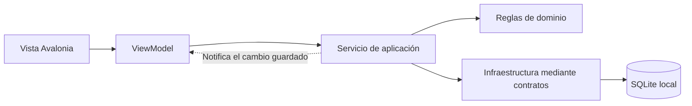

# SIGNA — Sistema Integral de Gestión de Notas y Asistencias


Aplicación de escritorio independiente de cualquier institución para materias, estudiantes, notas y asistencias. Se abre sin cuenta ni inicio de sesión. Está desarrollada en C#/.NET 10, Avalonia UI y SQLite, con capas Domain, Application, Infrastructure y Desktop.

**Repositorio oficial:** [danielpose1996-stack/SIGNA](https://github.com/danielpose1996-stack/SIGNA). **Licencia:** [MIT](LICENSE).

SIGNA está pensado para que un docente conserve y consulte sus materias a lo largo de varios períodos académicos. La gestión diaria funciona sin internet: los datos se guardan en el computador y pueden trasladarse a otro equipo mediante respaldos locales cifrados. El repositorio contiene el software y sus pruebas; las bases de datos, listados reales de estudiantes y respaldos del docente no se publican.

## Descargar e instalar

Los instaladores se publican en **[Releases de SIGNA](https://github.com/danielpose1996-stack/SIGNA/releases/latest)**. No necesitas clonar el repositorio ni instalar el SDK de .NET para utilizarlos.

**Versión 1.6.0:** actualizaciones integradas mediante Velopack, búsqueda automática y manual, verificación de paquetes y protección de datos antes del reinicio. Añade AppImage Linux actualizable y conserva los instaladores nativos. Consulta el [historial de cambios](CHANGELOG.md) o las [notas de SIGNA 1.6.0](https://github.com/danielpose1996-stack/SIGNA/releases/tag/v1.6.0).

**Manual de usuario:** [Abrir o descargar el Manual de Usuario SIGNA (PDF)](docs/manuales/Manual_de_Usuario_SIGNA.pdf). Incluye la instalación y los procedimientos paso a paso para usar las materias, los estudiantes, las notas, las asistencias y los respaldos.

| Sistema y arquitectura | Descarga |
| --- | --- |
| Windows x64 | `SIGNA-1.6.0-windows-x64-setup.exe` |
| Linux x64 o ARM64, actualización integrada | `SIGNA-1.6.0-linux-x64.AppImage` o `SIGNA-1.6.0-linux-arm64.AppImage` |
| Ubuntu/Debian x64 o ARM64 | `SIGNA-1.6.0-linux-x64.deb` o `SIGNA-1.6.0-linux-arm64.deb` |
| Fedora y derivados x64 o ARM64 | `SIGNA-1.6.0-linux-x64.rpm` o `SIGNA-1.6.0-linux-arm64.rpm` |
| Arch Linux / Omarchy x64 | `SIGNA-1.6.0-archlinux-x64.pkg.tar.zst` |
| macOS 15 o posterior, Intel | `SIGNA-1.6.0-osx-x64.dmg` |
| macOS 15 o posterior, Apple Silicon | `SIGNA-1.6.0-osx-arm64.dmg` |

Windows muestra la licencia MIT y permite **elegir la carpeta de instalación**; instala para tu usuario y crea accesos en Inicio y el escritorio. El asistente conserva Velopack como gestor de instalación, actualizaciones y desinstalación. Elige una carpeta vacía con permisos de escritura o una instalación compatible de SIGNA; se rechazan destinos con datos o archivos ajenos. Los paquetes nativos de Linux instalan sus archivos y la entrada del menú mediante el gestor de paquetes; AppImage se ejecuta desde una carpeta propia estable y escribible, con permiso de ejecución. En macOS abre el DMG y arrastra SIGNA a Applications. Las actualizaciones y desinstalaciones conservan la base y los respaldos de tu carpeta de usuario; haz un respaldo antes de actualizar.

**Revisión del instalador Windows 1.6.0:** se añadió el asistente de carpeta/licencia manteniendo la misma versión. Descarga nuevamente el EXE de esta Release para utilizarlo. Los paquetes de actualización de Velopack y las descargas de macOS/Linux conservan sus archivos originales; el hash del EXE se actualiza en `SHA256SUMS.txt`.

**Arch Linux / Omarchy (x86_64):** descarga el paquete `.pkg.tar.zst` y ejecuta `sudo pacman -U ./SIGNA-1.6.0-archlinux-x64.pkg.tar.zst`. Incluye .NET y declara sus bibliotecas nativas, incluido XWayland para escritorios Wayland como Hyprland. Puedes abrir SIGNA desde el menú de aplicaciones o ejecutar `signa`. Para desinstalar: `sudo pacman -R signa`. No requiere AUR ni convertir paquetes DEB/RPM. La comprobación automatizada de instalación se realiza en Arch; la revisión visual en Omarchy queda pendiente del docente. También puedes utilizar la AppImage x64 si prefieres la actualización integrada.

Lee [las instrucciones completas](eng/INSTALL.md) y compara los hashes con `SHA256SUMS.txt` de la Release. **Esta distribución no tiene firma oficial de Windows ni certificado Apple Developer ID/notarización:** pueden aparecer advertencias de seguridad. La firma ad hoc de macOS comprueba integridad, sin acreditar al desarrollador. No se necesita desactivar las protecciones globales del equipo.

## Qué permite hacer

**Actualización 1.6.0 — disponible en Releases:**

- Comprobación de versiones estables en segundo plano al iniciar, sin impedir trabajar sin internet, y opción **Buscar actualizaciones** en el menú lateral.
- Aviso con versión actual y nueva; **Actualizar SIGNA** descarga, verifica, instala y reinicia, con progreso, cancelación antes del reinicio y posibilidad de reintentar si falla.
- Protección de SQLite, preferencias y respaldos: verifica integridad, rechaza paquetes dañados y bloquea el reinicio ante cambios sin guardar, operaciones activas u otras instancias. No cambia las reglas académicas, el esquema ni la ubicación de los datos.
- Instaladores preparados con Velopack para Windows y macOS; nueva edición AppImage actualizable para Linux, conservando DEB, RPM y Arch/Omarchy bajo sus gestores de paquetes.

Las instalaciones hasta 1.5.0 requieren instalar una vez la nueva edición para recibir actualizaciones internas posteriores. Descarga la edición de tu sistema en [SIGNA 1.6.0](https://github.com/danielpose1996-stack/SIGNA/releases/tag/v1.6.0). Consulta [el procedimiento, la arquitectura y la protección de datos](docs/ACTUALIZACIONES.md), el [historial de cambios](CHANGELOG.md) y las [notas de la actualización](eng/RELEASE.md).

Consulta primero [Descargar e instalar](#descargar-e-instalar) si solo necesitas utilizar SIGNA.

| Módulo | Funciones actuales |
| --- | --- |
| **Inicio** | Consultar métricas de rendimiento por materia y corte: promedio, mínimo, máximo y registros completos o pendientes. |
| **Mis Materias** | Crear períodos académicos, crear y editar asignaturas, consultar tarjetas y abrir una materia. Copiar parámetros para reutilizar evaluaciones, porcentajes y nota de asistencia habilitada en una materia nueva de cualquier semestre, sin estudiantes ni registros. Eliminar materias y semestres con confirmación. |
| **Estudiantes dentro de una materia** | Importar el listado desde `.xls`, `.xlsx`, `.xlsm` o `.xlsb`, añadir estudiantes individualmente o pegar listas completas con revisión previa, y consultar, editar o eliminar su información. En el registro manual solo el nombre es obligatorio; documento y contactos son opcionales. Celular oculto inicialmente en detalles y revisión masiva. |
| **Notas** | Crear actividades con nombre libre y porcentaje, usar nota directa o subactividades con promedio simple o ponderado opcional, registrar notas de 0,0 a 5,0 y calcular el resultado del corte. Pegar una columna de notas con vista previa, ordenar nombres A–Z/Z–A y generar un PDF de toda la lista, identificada solo por nombre. |
| **Nota consolidada** | Consultar los resultados de todos los cortes y la nota final ponderada; configurar porcentajes cuya suma sea 100 %. |
| **Asistencias** | Crear y editar semanas de clase o actividades con fecha opcional, registrar P/A/J/T, marcar presente a todos opcionalmente y consultar porcentajes, clasificación y gráfico del grupo. Orden visual por nombre, nota opcional de asistencia por corte, numeración visible consecutiva y PDF individual. |
| **Respaldos** | Guardar y restaurar una copia local cifrada de toda la base SQLite, con contraseña, comprobaciones de integridad y confirmación antes de reemplazar datos. |
| **Apariencia** | Elegir un color con lienzo HSV y código HEX sincronizados, configurar nombre e icono del docente y activar o desactivar fondos de rendimiento en las definitivas. Conservar las preferencias para próximos inicios y respaldos. |

No se necesita servidor, cuenta de SIGNA ni inicio de sesión para usar estas funciones. Los respaldos se guardan únicamente de forma local; el usuario elige dónde crear el archivo y desde dónde restaurarlo.

### Reutilizar la configuración de una materia

En **Mis Materias**, elige el semestre de origen y pulsa **Copiar parámetros** en la tarjeta de la materia. Cambia al semestre de destino, abre **Crear materia**, completa su identidad y pulsa **Pegar parámetros**. Revisa el resumen por corte antes de guardar; **Usar configuración inicial** permite quitar la copia y comenzar con tres cortes vacíos.

Se copian los cortes y sus porcentajes, las actividades y subactividades activas, el promedio simple o ponderado y la configuración de nota de asistencia que esté habilitada. No se copian estudiantes, datos de contacto, calificaciones, semanas ni asistencias. La nueva materia es independiente y sus parámetros se pueden editar sin afectar el origen. La copia temporal permanece disponible hasta cerrar SIGNA; copiar otra materia la reemplaza. Los porcentajes de cortes pendientes de ajuste se conservan y se avisa de ello, sin redistribuirlos automáticamente.

### Registro masivo de estudiantes

En una materia, abre **Agregar estudiante → Varios estudiantes**. Pega un nombre completo por línea en Nombres completos. Si tienes documentos, correos o celulares, pega cada lista en su columna y en el mismo orden. Cada columna opcional utilizada debe tener tantas filas como nombres; deja una línea vacía donde falte un dato. Las columnas que no uses pueden quedar completamente vacías. Pulsa **Revisar lista**, comprueba la correspondencia de los datos y corrige las filas señaladas antes de pulsar **Agregar estudiantes**. Los documentos no vacíos deben ser únicos dentro de la materia; el registro masivo no sobrescribe estudiantes existentes. Modificar una lista exige revisarla nuevamente y un error conserva el borrador.

### Importación, pegado de notas y valoración de asistencia

La importación admite libros locales XLS, XLSX, XLSM y XLSB sin Excel instalado. Conserva la vista previa y la corrección de columnas; los libros dañados, cifrados o incompatibles se rechazan con indicaciones para guardar otra copia. No se ejecutan macros, vínculos ni fórmulas. En XLS/XLSB se usan los valores guardados y se advierte de ello antes de importar. ExcelDataReader 3.9.0 (MIT) lee los formatos binarios; el lector SpreadsheetML existente conserva sus controles para XLSX/XLSM. Los límites son 20 MiB por archivo, 80 MiB de ZIP expandido, 10000 filas por hoja, 256 columnas y 250000 celdas por libro.

En Notas, pulsa **Pegar notas** en el encabezado de una actividad directa o subactividad. Pega una sola columna, con una nota por línea y coma o punto decimal. **Vista previa** muestra los nombres en el orden visible al abrir la ventana, incluyendo el filtro de búsqueda. La cantidad debe coincidir exactamente y todas las notas deben estar entre 0 y 5. Confirma el reemplazo si ya existen notas y pulsa **Guardar calificaciones**. El lote se guarda en una sola transacción; cancelar o una validación fallida no cambia datos. Los promedios calculados no admiten pegado. En Notas y Asistencias, el encabezado **Nombre completo** alterna A–Z/Z–A sin cambiar los registros almacenados.

**Ponderación interna de subactividades:** en **Actividades y porcentajes**, selecciona la actividad, activa **Asignar porcentajes a las subactividades** e introduce los valores en **% interno**. Deben sumar exactamente 100 %. Por ejemplo, Teoría 40 % con nota 3,0 y Práctica 60 % con nota 5,0 producen 4,2; el porcentaje principal del parcial dentro del corte se conserva. Si desactivas la opción se usa el promedio simple, conservando los porcentajes para reactivarlos. Las notas vacías aportan cero únicamente al cálculo. Los encabezados y el PDF distinguen los porcentajes internos del peso de la actividad en el corte.

En Asistencias, **Activar nota de asistencia** permite definir los cuatro valores P/A/J/T para el corte seleccionado. La nueva columna muestra su promedio simple entre semanas activas con estado asignado, incluida J; los registros vacíos o sin clase se excluyen. Desactivar oculta la columna y conserva la configuración. Esta nota es informativa: no modifica el porcentaje o clasificación de asistencia ni interviene en las notas académicas o la consolidada. La configuración se conserva en la materia y en sus respaldos locales.

## Arquitectura

SIGNA es una aplicación de escritorio por capas. Su backend son servicios C# ejecutados dentro del propio proceso de la aplicación; no hay una API HTTP ni un servidor independiente que instalar. Avalonia construye la interfaz nativa con AXAML y utiliza el patrón **MVVM** para separar las vistas de su estado y sus acciones.

| Proyecto | Responsabilidad | Ejemplos |
| --- | --- | --- |
| `GestorDocente.Domain` | Modelos y reglas académicas, sin acceso a la interfaz ni a SQLite. | Estudiantes, cortes, actividades, semanas, validación de porcentajes, cálculo de notas y resumen de asistencia. |
| `GestorDocente.Application` | Casos de uso y contratos de los servicios. Coordina validación, cambios y guardado. | `WorkspaceService`, `CatalogService`, importación, proyecciones de métricas/PDF y contratos de almacenamiento y respaldos. |
| `GestorDocente.Infrastructure` | Implementaciones que leen o escriben archivos y datos. | `Microsoft.Data.Sqlite`, lectura de Excel, generación de PDF con SkiaSharp, respaldos cifrados y preferencias de apariencia. |
| `GestorDocente.Desktop` | Presentación Avalonia y composición de los servicios. | Vistas AXAML, ViewModels, navegación, diálogos, estilos compartidos, iconos y configuración de publicación por plataforma. |

El flujo de una operación, por ejemplo crear una semana con todos presentes, es:



Las dependencias de compilación siguen esa separación: Application referencia Domain; Infrastructure referencia Application y accede a Domain mediante esa dependencia; Desktop compone Application e Infrastructure. Las reglas de notas y el acceso a SQLite permanecen fuera del code-behind de las ventanas.

### Persistencia y protección de datos

SQLite guarda el catálogo de semestres y materias, las preferencias de interfaz y el estado académico de cada materia. En el esquema actual, el estado de una materia —estudiantes, cortes, actividades, notas y asistencias— se conserva como un agregado JSON versionado en `course_workspaces`, asociado al catálogo por su identificador. No existe una tabla SQL independiente por cada nota o celda de asistencia.

Las operaciones de guardado utilizan transacciones y control de revisión: si otra instancia modificó la materia, el cambio se rechaza y se informa al usuario. La preparación y persistencia de las operaciones asíncronas se ejecutan fuera del hilo de la interfaz; sus notificaciones actualizan las tablas y los resúmenes después del guardado. La búsqueda de estudiantes filtra las proyecciones en memoria y no consulta SQLite por cada tecla.

Los respaldos usan la API de copia consistente de SQLite, validan integridad física, relaciones y datos académicos, y cifran el archivo con una contraseña elegida por el docente. La aplicación no conserva esa contraseña. Antes de una restauración se verifica la copia y se protege el estado actual mediante un respaldo preventivo. La base activa sigue siendo un archivo SQLite sin cifrar; el cifrado corresponde a los archivos de respaldo.

### Estructura del repositorio

```text
SIGNA/
├── src/
│   ├── GestorDocente.Domain/
│   ├── GestorDocente.Application/
│   ├── GestorDocente.Infrastructure/
│   └── GestorDocente.Desktop/
│       ├── Assets/Branding/
│       ├── Controls/
│       ├── Packaging/       # Recursos y publicación para macOS/Linux
│       ├── Styles/
│       ├── ViewModels/
│       └── Views/
├── tests/
│   ├── GestorDocente.Domain.Tests/
│   ├── GestorDocente.Application.Tests/
│   ├── GestorDocente.Infrastructure.Tests/
│   └── GestorDocente.Acceptance.Tests/
├── GestorDocente.slnx
├── Directory.Build.props
├── Directory.Packages.props
├── Iniciar.cmd
├── Iniciar-demo.cmd
└── LICENSE
```

Los nombres técnicos `GestorDocente` y la ubicación histórica de almacenamiento `AulaRegistro` se conservan por compatibilidad; la identidad visible del programa es SIGNA. Las versiones de NuGet se centralizan en `Directory.Packages.props` y los archivos `packages.lock.json` mantienen la resolución de dependencias.

## Obtener el código y comenzar

Para compilar desde el código fuente necesitas Git y el **SDK de .NET 10**. Clona el repositorio y restaura sus dependencias:

```sh
git clone https://github.com/danielpose1996-stack/SIGNA.git
cd SIGNA
dotnet restore GestorDocente.slnx --locked-mode
dotnet build GestorDocente.slnx
```

En Windows puedes usar el iniciador descrito abajo. En macOS y Linux, con sus dependencias de escritorio instaladas:

```sh
dotnet run --project src/GestorDocente.Desktop
```

Para comenzar a trabajar, crea un período académico, crea una materia, importa o añade estudiantes y configura las actividades del primer corte. Puedes registrar notas y asistencias de forma independiente. Las publicaciones autocontenidas descritas más adelante incluyen .NET; en el equipo destino se necesita toda la carpeta publicada y las bibliotecas nativas correspondientes al sistema operativo.

## Ejecutar en Windows

Con el SDK de .NET 10 instalado, desde PowerShell en la carpeta del proyecto:

```powershell
.\Iniciar.cmd
```

El iniciador compila antes de abrir; por eso puede tardar varios segundos. Para ejecutar una compilación ya existente directamente:

```powershell
dotnet run --project src\GestorDocente.Desktop --no-build --no-restore
```

Si existe un SDK portátil en `.tools/dotnet`, el iniciador lo utiliza automáticamente. SIGNA conserva la carpeta histórica `AulaRegistro` y el archivo `aula-registro.db` de datos locales del usuario para seguir abriendo las materias y preferencias existentes. `GESTOR_DOCENTE_DATA_DIR` permite elegir otro directorio local. Los identificadores técnicos de proyectos y formatos también se conservan por compatibilidad. Evita carpetas compartidas de red o sincronizadas para la base activa.

## Uso académico

Primero crea un período académico, por ejemplo `2026-1`, y luego una asignatura con código, nombre y escuela. Importa un libro `.xls`, `.xlsx`, `.xlsm` o `.xlsb`: se guardan documento, nombre y, cuando estén disponibles, correo y celular. La importación detecta las columnas y permite corregirlas para todo el listado; reimportar contactos conserva los nombres, notas y asistencias existentes. En Notas, **Agregar estudiante** requiere únicamente nombre completo y **Ver detalles** muestra sus contactos, con el celular oculto hasta pulsar el ojo. Los documentos no vacíos deben ser únicos dentro de la materia.

Desde **Ver detalles → Editar información** puedes cambiar nombre, documento, correo y celular, conservando el identificador, las notas y las asistencias. Solo el nombre es obligatorio; los demás campos pueden vaciarse. **Eliminar estudiante** solicita confirmación y retira únicamente a ese alumno y sus notas/asistencias de todos los cortes de la materia actual. Las otras materias y estudiantes se conservan.

Las pestañas académicas son **Notas**, **Asistencias** y **Nota consolidada**. El botón **Actividades y porcentajes** de Notas conserva la configuración de evaluaciones. Importación, matrícula manual y detalles siguen disponibles en esa pantalla.

**Inicio** muestra únicamente las métricas de rendimiento de cada materia y corte: promedio, mínimo, máximo y cantidad de estudiantes completos/pendientes. Puedes seleccionar el período y actualizar los resultados. La consulta individual de calificaciones permanece dentro de la materia, en Notas y Nota consolidada.

Para personalizar el programa, pulsa el perfil inferior → **Personalizar apariencia**. Configura tu nombre y avatar y elige el color en el lienzo de saturación/brillo y el deslizador de tono HSV, o escribe un código **HEX #RRGGBB**. Ambos controles están sincronizados y el color se previsualiza en tiempo real. **Guardar apariencia** lo conserva en SQLite; **Cancelar** o cerrar restaura el color guardado. Las paletas predeterminadas se retiraron; el color de configuraciones anteriores se conserva al leerlas. Nombre, color, avatar y la casilla de rendimiento forman parte de los respaldos locales.

Cada materia inicia con tres cortes y permite **Agregar corte**. En cada corte configura actividades principales cuyos porcentajes suman 100 %. Cada actividad puede usar una nota directa o el promedio simple de subactividades. Las notas válidas son de 0,0 a 5,0; las vacías aportan cero únicamente al cálculo.

En **Nota consolidada** consulta todos los cortes y la nota final acumulada. Los pesos iniciales son 30 %, 30 % y 40 %; los cortes adicionales comienzan con 0 %. **Configurar porcentajes** permite modificarlos, siempre con total de 100 %. Los cálculos no redondean valores intermedios y se muestran con dos decimales.

La papelera junto a cada corte permite **Eliminar corte** con confirmación: elimina permanentemente sus actividades, subactividades, notas y asistencias. Siempre debe quedar al menos un corte. Los restantes se renumeran y conservan sus porcentajes; se abre la revisión de ponderaciones. Si el total no es 100 %, puedes seguir registrando notas y asistencias, pero la nota final queda pendiente hasta ajustar los porcentajes.

En **Notas → Generar reporte PDF** puedes elegir dónde guardar todas las calificaciones del corte seleccionado, incluso si la tabla tiene un filtro. El reporte identifica a cada estudiante únicamente por su nombre: no incluye documentos, correos ni teléfonos. Muestra actividades, subactividades, porcentajes y definitiva; mantiene vacías las celdas pendientes y usa cero solo para calcular. Si hay muchas columnas, las divide en secciones con nombre y definitiva repetidos.

Las asistencias admiten hasta nueve semanas por corte, de clase o actividades, con fecha opcional y estados P/A/J/T. P y T cuentan como asistencia; A como inasistencia; J, sin clase y pendientes se excluyen del denominador. El PDF individual permite elegir dónde guardarlo e incluye las fechas asignadas, registros y resumen del estudiante.

El porcentaje individual se calcula como `(P + T) / (P + T + A) × 100`. El gráfico del grupo utiliza la suma global de esos registros, independientemente de la búsqueda activa. La clasificación es Excelente (100 %), Bueno (desde 75 %), Regular (desde 50 %) y Bajo (menos de 50 %); sin registros evaluables se muestra Sin registros.

Al crear una semana puedes activar **Marcar presente a todos**: se guardan la semana y un P para cada estudiante de la materia en una sola operación. La opción inicia desactivada y vuelve a desactivarse después de crear la semana; sin activarla, las celdas quedan pendientes como antes. Puedes cambiar cualquier asistencia después. El porcentaje, el gráfico, el detalle y el PDF utilizan los registros actualizados.

En **Respaldos** puedes crear un archivo local cifrado `.aulabk` y restaurarlo con la contraseña que elijas. Consérvala: la aplicación no la almacena ni puede recuperarla. Cierra otras instancias antes de restaurar. Antes de reemplazar una base se verifica el respaldo y se crea una copia preventiva cifrada en `Recovery` junto a los datos locales. El PDF individual permanece en Asistencias; Reportes se retiró del menú lateral.

## Respaldos locales completos

1. Abre **Respaldos → Crear respaldo cifrado**, elige una contraseña de al menos 12 caracteres y selecciona dónde guardar un archivo nuevo `.aulabk`. No se sobrescriben copias existentes.
2. El archivo contiene toda la base de SIGNA: semestres (también los vacíos), materias, estudiantes con documento/nombre/correo/celular, cortes y ponderaciones, actividades/subactividades, notas y asistencias con sus tipos y fechas. También conserva los registros retirados, los identificadores que mantienen las relaciones y el nombre, color e icono del perfil configurados.
3. La copia se genera con [BackupDatabase de Microsoft.Data.Sqlite](https://learn.microsoft.com/en-us/dotnet/standard/data/sqlite/backup), incluyendo los cambios confirmados que estén en WAL. Se comprueban integridad SQLite, claves foráneas y datos académicos, sin modificar los payloads ni sus revisiones. El archivo cifrado también se verifica antes de publicarlo.
4. Para continuar en otro computador, instala una versión compatible de SIGNA y copia el archivo `.aulabk`. En **Elegir copia y restaurar**, selecciona el archivo, introduce su contraseña y revisa la confirmación. Se recupera el catálogo completo; se reemplazan los datos actuales después de conservar una copia preventiva cifrada en `Recovery`.
5. Si la contraseña, el archivo, la versión o las relaciones son inválidos, la restauración se rechaza y los datos actuales se conservan. La aplicación no almacena ni recupera contraseñas. Cierra otras instancias antes de restaurar.

Los respaldos funcionan sin cuenta ni internet. La selección de carpetas y archivos se realiza mediante los diálogos del sistema operativo. Las copias previas `.aulabk` mantienen su compatibilidad.

La base SQLite activa usa los permisos de la cuenta del sistema operativo y **no está cifrada**; los archivos de respaldo sí lo están. Mantén protegida la cuenta y el disco del equipo. No incluyas bases, archivos `.aulabk` ni listados de alumnos en commits o incidencias públicas.

## Icono oficial y distribución

Los archivos originales ICO, PNG e ICNS están en `src/GestorDocente.Desktop/Assets/Branding`. Windows usa el ICO en las ventanas, ejecutable, instalador y accesos directos; Avalonia utiliza el PNG en otros sistemas. No se necesitan rutas externas. Los paquetes Linux registran el acceso del menú; para una publicación portátil puedes usar el script opcional descrito abajo.

Publicar para Windows x64, con el SDK de .NET 10:

```powershell
dotnet publish src/GestorDocente.Desktop -c Release -r win-x64 --self-contained true
```

El ejecutable queda en `src/GestorDocente.Desktop/bin/Release/net10.0/win-x64/publish/GestorDocente.Desktop.exe`. Distribuye toda la carpeta `publish`. Si Windows conserva un icono antiguo, comprueba primero este ejecutable nuevo y vuelve a crear o anclar su acceso directo; no hace falta cambiar datos ni configuración del programa.

Estos comandos `dotnet publish` generan binarios de desarrollo/distribución manual, sin preparar un instalador actualizable. Para la distribución con Velopack usa `eng/package-windows.ps1`, `eng/package-linux.sh` o `eng/package-macos.sh` en su sistema nativo, o el workflow de Release. Los paquetes y sus canales se describen en [Actualizaciones](docs/ACTUALIZACIONES.md).

Publicar para macOS Apple Silicon (usa `osx-x64` para Mac Intel):

```sh
dotnet publish src/GestorDocente.Desktop -c Release -r osx-arm64 --self-contained true -p:UseAppHost=true
```

Se genera `src/GestorDocente.Desktop/bin/Release/net10.0/osx-arm64/SIGNA.app`, con el ICNS original en `Contents/Resources` y su referencia en `Info.plist`, siguiendo la [estructura de distribución de Avalonia para macOS](https://docs.avaloniaui.net/docs/deployment/macos). Si publicas desde Windows, en el Mac asigna permiso de ejecución con `chmod +x SIGNA.app/Contents/MacOS/GestorDocente.Desktop`. El bundle no incluye firma, notarización ni instalador; su ejecución y visualización en Finder/Dock deben comprobarse en macOS.

La verificación visual de barra de título, barra de tareas, accesos directos y Dock corresponde a las pruebas manuales del docente. La compilación y las pruebas automatizadas comprueban recursos y aplicación del icono sin abrir la aplicación de escritorio.

### Linux de escritorio

Publicar una versión autocontenida (no necesita instalar .NET en el equipo destino):

```sh
dotnet publish src/GestorDocente.Desktop -c Release -r linux-x64 --self-contained true -p:UseAppHost=true
```

Usa `linux-arm64` para equipos ARM64. Copia **toda** la carpeta `src/GestorDocente.Desktop/bin/Release/net10.0/linux-x64/publish` a una ubicación estable del equipo Linux. Desde esa carpeta:

```sh
chmod +x GestorDocente.Desktop
./GestorDocente.Desktop
```

Las ventanas usan el mismo PNG oficial de SIGNA. Para añadir SIGNA al menú de aplicaciones con ese icono, desde la carpeta copiada ejecuta opcionalmente `sh Registrar-icono.sh`. Registra el acceso y una copia intacta del PNG en las carpetas XDG del usuario, sin permisos de administrador. Si mueves la carpeta del programa, ejecuta otra vez el registro desde su nueva ubicación. El registro no inicia el programa ni modifica datos.

La versión actual de Avalonia utiliza X11 y, en una sesión Wayland, XWayland. El sistema debe disponer de las [bibliotecas nativas de Avalonia](https://docs.avaloniaui.net/docs/deployment/linux) (`libx11-6`, `libice6`, `libsm6`, `libfontconfig1` en Debian/Ubuntu) y de las [dependencias nativas de .NET 10 para su distribución](https://learn.microsoft.com/en-us/dotnet/core/install/linux). La publicación autocontenida incluye el runtime .NET y las bibliotecas de SQLite/Skia, pero requiere las bibliotecas del sistema; usa una distribución soportada por .NET 10, por ejemplo Ubuntu 24.04 con sus dependencias instaladas. No se han instalado bibliotecas ni realizado pruebas manuales de Linux desde el equipo Windows.

Para ejecutar desde el código fuente en Linux, con el SDK de .NET 10 instalado: `dotnet run --project src/GestorDocente.Desktop`. Los datos mantienen su ubicación de usuario mediante `LocalApplicationData`; en Linux normalmente se encuentran bajo `~/.local/share/AulaRegistro`, o en `GESTOR_DOCENTE_DATA_DIR` si se configura. Para trasladar datos entre equipos utiliza el respaldo local cifrado existente.

## Desarrollo y pruebas

```powershell
dotnet test GestorDocente.slnx
```

Las pruebas usan datos ficticios y bases temporales. Las materias guardadas con el formato anterior se actualizan al abrirlas, conservando sus registros y ponderaciones configuradas. Solo los formatos antiguos que no tenían ponderaciones reciben los pesos iniciales 30/30/40. No utilices una versión anterior del programa para abrir datos del formato nuevo.

| Conjunto de pruebas | Qué verifica |
| --- | --- |
| Domain | Reglas académicas, porcentajes, notas válidas y clasificación de asistencia. |
| Application | Casos de uso, cálculo consolidado, importación, cambios de cortes y proyecciones de reportes. |
| Infrastructure | Persistencia en SQLite temporal, conflictos de revisión, integridad, Excel, PDF y respaldos/restauración. |
| Acceptance | ViewModels y controles Avalonia con Headless: navegación, formularios, tablas, selección y actualización de métricas. |

La validación de 1.6.0 aprobó **427 pruebas de la aplicación en cada uno de los cinco sistemas/arquitecturas y 6 pruebas de empaquetado**, con compilaciones Release correctas. Incluye fallos de red, cancelación, caché corrupta, datos SQLite ficticios con WAL, conservación de notas y preferencias, y presentación Avalonia Headless. El workflow generó los diez instaladores/distribuciones y los cinco canales de actualización en sistemas nativos, comprobó instalación/desinstalación en Windows y Arch, paquetes Linux, bundles macOS y hashes antes de publicar. El ciclo real de actualización y reinicio entre versiones instaladas y la revisión del escritorio corresponden a las pruebas manuales del docente. macOS todavía requiere firma/notarización si se distribuye como una aplicación firmada.

## Contribuir y gestionar cambios

La rama principal es `main`. Después de clonar, Git configura automáticamente `origin` con la URL de SIGNA. Puedes comprobar y actualizar tu copia con:

```sh
git remote -v
git fetch origin
git pull --ff-only origin main
```

Para proponer una mejora, crea una rama, describe el problema y la solución, ejecuta las pruebas pertinentes y abre un pull request. Los commits del proyecto se escriben en español. Si no tienes permiso de escritura, utiliza un fork: el acceso público al código y la licencia MIT permiten consultarlo y reutilizarlo, pero no conceden permisos para cambiar este repositorio directamente.

Mantén las reglas académicas en Domain/Application, la persistencia en Infrastructure y la presentación en Desktop. Incluye pruebas para cambios de cálculos, importación o integridad de datos. No adjuntes bases reales, listados de estudiantes, contraseñas ni respaldos a commits o incidencias; utiliza datos ficticios para reproducir problemas. Los archivos de compilación, datos locales y material interno de trabajo están excluidos mediante `.gitignore`.

## Licencia

SIGNA se distribuye bajo la [licencia MIT](LICENSE). Puedes usar, estudiar, modificar y distribuir el software, conservando el aviso de copyright y la licencia.
