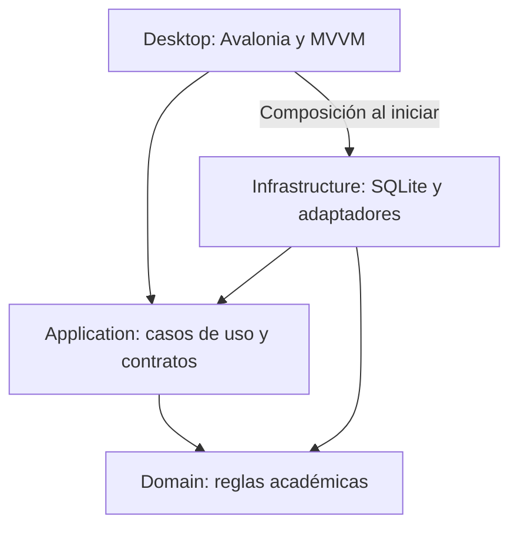

# Arquitectura propuesta

**Estado:** borrador para revisión. Fecha: 2026-10-11.

## Objetivo y límites

Mantener los cálculos académicos, los casos de uso, la interfaz y el almacenamiento separados. El stack procede del paquete original: .NET 10, Avalonia, MVVM y SQLite. No se ha seleccionado aún un ORM, biblioteca de Excel, generador PDF, framework de pruebas ni proveedor de cifrado.

## Capas

| Carpeta / futuro proyecto | Responsabilidad | Dependencias de proyecto permitidas |
| --- | --- | --- |
| GestorDocente.Domain | Entidades, reglas aprobadas y cálculos puros | Ninguna |
| GestorDocente.Application | Casos de uso, contratos de almacenamiento y servicios, coordinación de validaciones | Domain |
| GestorDocente.Infrastructure | SQLite y migraciones; adaptadores de Excel, PDF, cifrado y Drive | Application y Domain |
| GestorDocente.Desktop | Vistas AXAML, ViewModels y composición de la aplicación | Application; Infrastructure solo para composición |

Los ViewModels invocarán casos de uso; no abrirán conexiones SQLite ni realizarán llamadas a Drive. El dominio no dependerá de Avalonia, SQLite ni servicios externos. Las implementaciones de infraestructura se conectarán a los contratos desde el punto de composición del escritorio.

## Organización interna prevista

- Domain: entidades, objetos de valor, políticas aprobadas y resultados de validación.
- Application: casos de uso organizados por módulo, contratos y modelos de entrada/salida.
- Infrastructure: persistencia y migraciones, importación, informes y respaldos.
- Desktop: Views, ViewModels, recursos visuales y composición.

Crear estas subdivisiones cuando tengan código real; evitar capas o abstracciones sin un caso de uso.

## Modelo conceptual a revisar

| Concepto | Relación propuesta |
| --- | --- |
| Materia | Contiene grupos académicos |
| Grupo académico | Reúne matrículas de estudiantes y tres cortes |
| Estudiante / matrícula | Separa la identidad del estudiante de su pertenencia al grupo; identidad pendiente de definir |
| Corte | Tiene configuración de evaluación, hoja de notas y semanas registradas |
| Grupo de evaluación | Contiene actividades y un porcentaje; no confundir con el grupo académico |
| Actividad | Recibe una nota por estudiante y puede tener una rúbrica propia |
| Parcial | Actividad individual sin subactividades |
| Rúbrica | Define criterios para una actividad; escala y conversión pendientes |
| Semana / sesión de clase | Permite registrar estados; relación semana-sesión pendiente |
| Registro de asistencia | Relaciona estudiante y período registrado |
| Respaldo | Archivo fechado, cifrado y verificable; formato pendiente |

Esta tabla no es un esquema SQL aprobado. Las restricciones, índices, identificadores, migraciones y políticas de borrado se definirán con la especificación del módulo.

## Persistencia y recuperación

SQLite será local. Las operaciones que afecten varios registros deberán ser atómicas cuando lo requiera la especificación. Las migraciones deberán ser versionadas y probadas antes de usarse con datos del docente. La ubicación de la base, el modo de concurrencia y la estrategia de migración están pendientes.

El respaldo se obtendrá mediante una API consistente de SQLite. Antes de restaurar, se verificarán integridad, descifrado y compatibilidad; no se reemplazarán datos actuales antes de comprobar el archivo. El mecanismo concreto de recuperación se aprobará en el módulo 007.

## Interfaz y pruebas

Estilo universitario sobrio, tablas con cebra, estados sin datos y errores visibles. Las rúbricas se construirán en una ventana modal. Falta aportar y aprobar maquetas.

Las pruebas del dominio cubrirán reglas académicas. Aplicación verificará casos de uso con dobles de los contratos. Infraestructura comprobará persistencia, importación y restauración con archivos temporales y datos ficticios. Aceptación trazará escenarios a sus IDs en `specs/`.

## Decisiones de arranque

Antes de crear los proyectos: aprobar esta separación, elegir y auditar dependencias, fijar versiones, confirmar el primer módulo y registrar las decisiones en `docs/decisions/`. La validación de macOS deberá realizarse en ese sistema; un build de Windows no prueba la compatibilidad completa.
